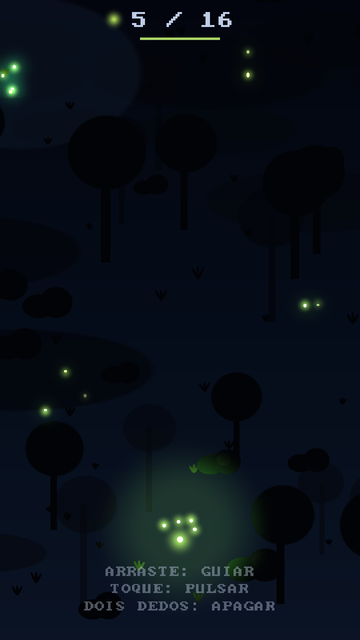
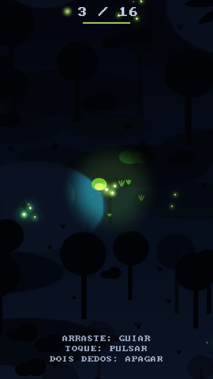
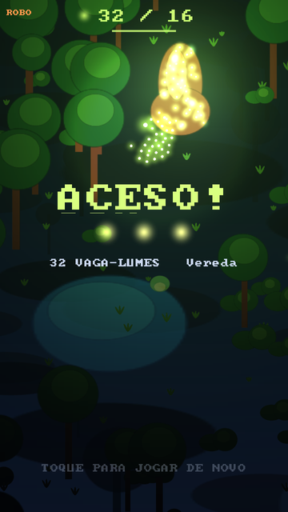

# Lume

Você é um vaga-lume. Reúna o enxame perdido na noite do cerrado e leve-o até
o cupinzeiro apagado para acendê-lo, como acontece de verdade no Parque
Nacional das Emas. Feito na engine
[Pequi](https://github.com/diegobezerradev/pequi) (Zig), para Android e PC
(Windows).

| | | | |
| --- | --- | --- | --- |
|  |  |  |  |

## Estado

**Fase 1 (fatia vertical):** uma fase jogável do começo ao fim, com arte e
sons provisórios feitos em código. O plano das próximas fases está em
`docs/PLAN.md`.

## Como se joga

| Ação | Toque | PC | O que faz |
| --- | --- | --- | --- |
| Guiar | arrastar | botão esquerdo | o líder voa para onde você aponta; o enxame vai atrás |
| Pulsar | toque rápido | clique | um clarão mostra o mapa e chama os perdidos de longe, mas acorda os predadores |
| Apagar | segurar dois dedos | botão direito ou Espaço | o enxame some no escuro: ninguém o vê, mas ele anda devagar, não resgata e se espalha |

- O tamanho do enxame é a sua vida e o alcance da sua luz.
- Vaga-lumes perdidos piscam pelo mapa; a luz do enxame os traz de volta.
- **Sapo:** fica na beira da lagoa. Incha e coaxa antes de dar o bote em
  quem brilha por perto. Não enxerga um enxame apagado. Um pulso por perto
  o acorda: por alguns segundos alcança mais longe e ataca mais rápido.
- O cupinzeiro acende com o número de vaga-lumes que ele pede. Quantos
  chegaram vale de uma a três estrelas.

Em builds Debug e ReleaseSafe: Enter liga um robô que joga sozinho; a tecla
I enche o enxame para medir o custo do frame.

## Requisitos e comandos

Zig **0.17.0** e o repositório `pequi` clonado ao lado deste.

```sh
zig build run                       # o jogo (no Windows)
zig build -Dtarget=x86_64-windows   # compila para Windows de outro sistema
zig build test                      # testes: simulação, predadores, robô, input
zig build robots                    # os robôs jogam cada fase e mostram o resultado
zig build check-render              # Linux: renderiza sem janela (GL e GLES)
zig build shots                     # Linux: roteiros em tools/shots/, capturas em zig-out/shots/
zig build stress                    # Linux: 200 vaga-lumes, custo do frame no log
zig build check-android             # Linux x86_64: o app num Android simulado
cd android && ./gradlew assembleDebug   # APK (Android SDK 35 e JDK 17)
```

O CI (`.github/workflows/ci.yml`) precisa do secret `PEQUI_TOKEN`, com
leitura em `diegobezerradev/pequi`.

## Como funciona

```
src/
  sim.zig        a fase: estado, passo fixo de 1/120 s, eventos
  boids.zig      o líder, o enxame (separação, alinhamento, coesão), os perdidos
  predators.zig  o sapo
  levels.zig     as fases, como dados
  robot.zig      um robô que joga pelos mesmos controles do jogador
  input.zig      mouse, dedos e teclas viram um só ponteiro
  game.zig       a fase na tela: câmera, luz, desenho, HUD, reação aos eventos
  art.zig        as texturas, geradas em código
  sfx.zig        os sons, gerados em código
  main.zig       memória, áudio, laço do frame
docs/
  ENGINE_NOTES.md  o que o jogo usa da engine
  ENGINE_GAPS.md   o que faltava nela, e o que foi feito
  PLAN.md          o plano
  BACKLOG.md       pendências
```

A simulação não desenha nem toca nada: recebe os controles, anda um passo e
devolve eventos. Com a mesma fase e os mesmos controles, o jogo é o mesmo,
e por isso os testes e o robô rodam sem janela.

A luz é o jogo. Todo frame, tudo é desenhado como silhueta contra o céu;
as luzes são somadas numa textura pequena (o mapa de luz); as cores da cena
são multiplicadas por ele e somadas por cima. Só há cor onde há luz.

## Licenças

Tudo aqui é original e gerado por código (texturas em `src/art.zig`, sons
em `src/sfx.zig`). Não há assets de terceiros.
