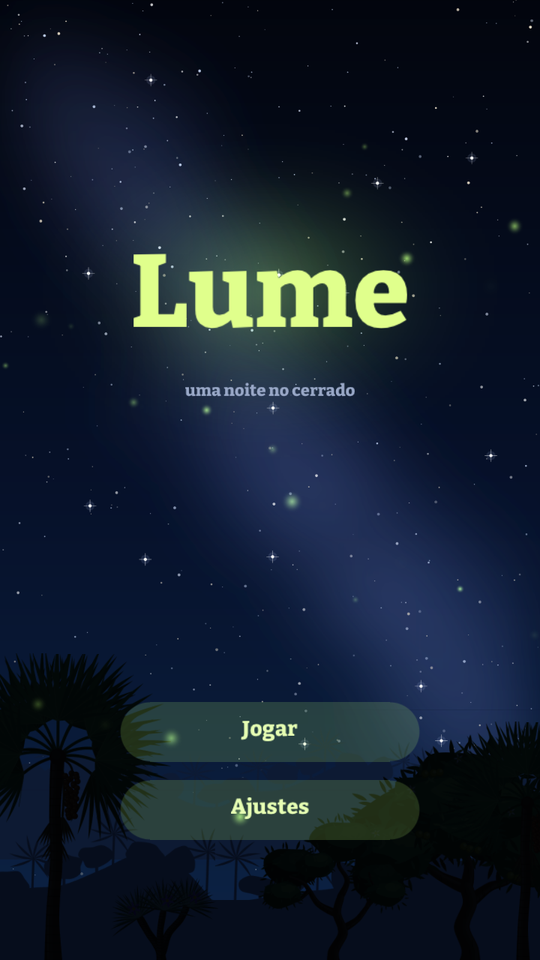
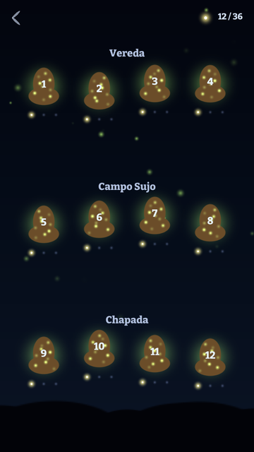
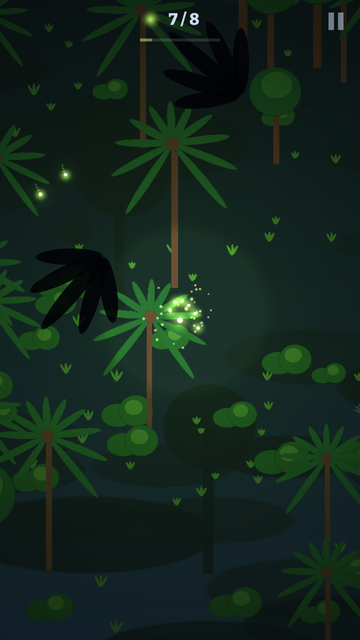
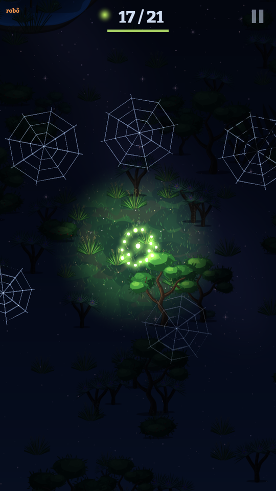
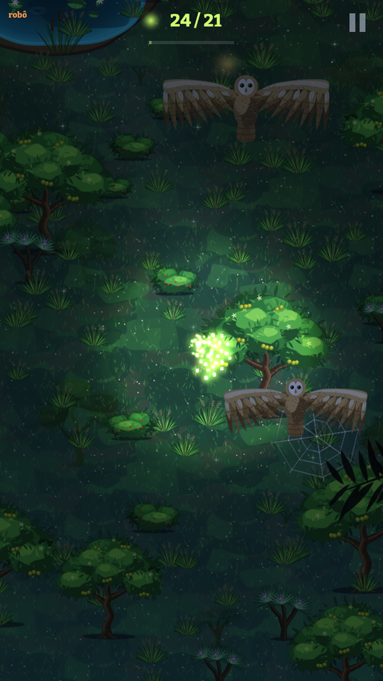
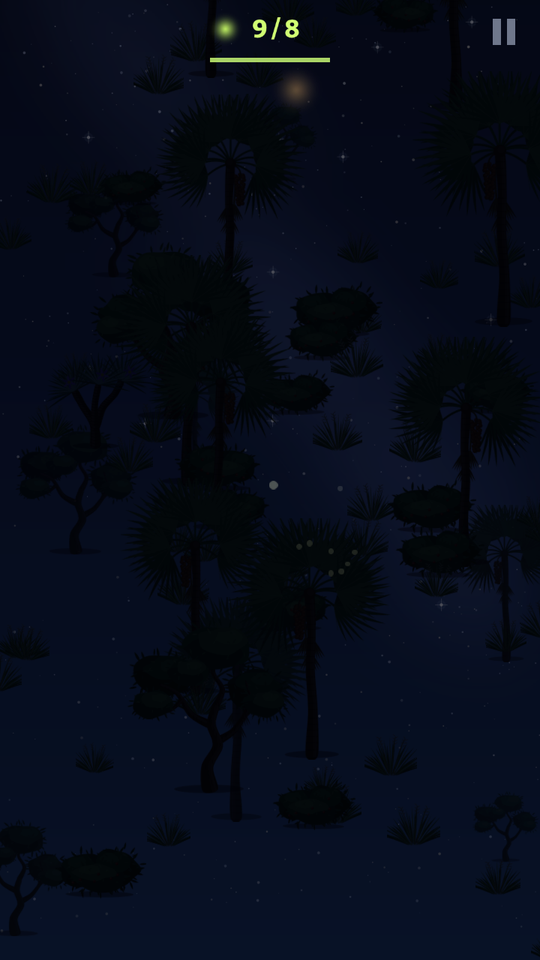

# Lume

Você é um vaga-lume. Reúna o enxame perdido na noite do cerrado e leve-o até
o cupinzeiro apagado para acendê-lo, como acontece de verdade no Parque
Nacional das Emas. Feito na engine
[Pequi](https://github.com/diegobezerradev/pequi) (Zig), para Android e PC
(Windows).

| | | |
| --- | --- | --- |
|  |  |  |
|  |  |  |

## Estado

**Completo nas três fases do plano:** 12 fases em três regiões, com
título, mapa, pausa, ajustes, progresso salvo e o polimento de game feel
(`docs/FEEL.md`). A arte é ilustrada e os sons são sintetizados. Falta
mais teste em aparelho; as pendências estão em `docs/BACKLOG.md`.

## Como se joga

| Ação | Toque | PC | O que faz |
| --- | --- | --- | --- |
| Guiar | arrastar | botão esquerdo | o líder voa para onde você aponta; o enxame vai atrás |
| Pulsar | toque rápido | clique | um clarão mostra o mapa, chama os perdidos de longe e rasga as teias por perto, mas acorda os predadores e gasta a luz: por 2,6 s o enxame ilumina menos da metade e vai voltando |
| Apagar | segurar dois dedos | botão direito ou Espaço | o enxame some no escuro: ninguém o vê, mas ele anda devagar, não resgata e se espalha |

- O tamanho do enxame é a sua vida e o alcance da sua luz.
- Vaga-lumes perdidos piscam pelo mapa; a luz do enxame os traz de volta.
- O cupinzeiro acende com o número de vaga-lumes que ele pede. Quantos
  chegaram vale de uma a três estrelas.
- Se os vaga-lumes que restam na fase não bastam para o cupinzeiro, a fase
  acaba ali.

| Quem | Regra | Como escapar |
| --- | --- | --- |
| Sapo | na beira da lagoa; incha e coaxa meio segundo antes de pegar quem brilha por perto. Um pulso o acorda: alcança mais longe e ataca mais rápido | apagar enquanto ele incha, ou passar longe |
| Aranha | a teia não se vê, só depois de um pulso. Quem voa nela fica preso, e a aranha come um a cada poucos segundos | pulsar perto da teia: ela rasga e solta todos |
| Coruja | faz a ronda lá do alto; mergulha num enxame aceso que ela veja, ou num pulso de muito longe. A sombra segue o enxame até a metade do mergulho e então para | sair da sombra depois que ela para, ou apagar |
| Lobo-guará | não é inimigo: atravessa a fase de vez em quando, e sapos, aranhas e corujas perto dele se escondem | |
| Vento | na Chapada, rajadas empurram o enxame; no escuro, espalham | ficar aceso durante a rajada |

| Região | Fases | O que chega |
| --- | --- | --- |
| Vereda | 1 a 4 | lagoas e sapos; a 1 ensina os gestos; o lobo-guará aparece na 4 |
| Campo Sujo | 5 a 8 | teias e aranhas, junto com os sapos |
| Chapada | 9 a 12 | corujas, e vento a partir da 10; a 12 tem tudo |

Em builds Debug e ReleaseSafe: Enter liga um robô que joga sozinho (no
mapa, abre todas as fases); a tecla I enche o enxame para medir o custo do
frame.

## Requisitos e comandos

Zig **0.17.0** e o repositório `pequi` clonado ao lado deste.

```sh
zig build run                       # o jogo (no Windows)
zig build -Dtarget=x86_64-windows   # compila para Windows de outro sistema
zig build test                      # testes: simulação, predadores, robô, input, progresso
python3 tools/levels.py --maps      # refaz a tabela das fases e desenha os mapas (Pillow)
zig build robots                    # os robôs jogam cada fase e mostram o resultado
zig build check-render              # Linux: renderiza sem janela (GL e GLES)
zig build shots                     # Linux: roteiros em tools/shots/, capturas em zig-out/shots/
zig build stress                    # Linux: 200 vaga-lumes, custo do frame no log
zig build check-android             # Linux x86_64: o app num Android simulado
cd android && ./gradlew assembleDebug   # APK (Android SDK 35 e JDK 17)
```

O CI (`.github/workflows/ci.yml`) precisa do secret `PEQUI_TOKEN`, com
leitura em `diegobezerradev/pequi`.

## Como funciona

```
src/
  sim.zig          a fase: estado, passo fixo de 1/120 s, eventos
  boids.zig        o líder, o enxame (separação, alinhamento, coesão), os perdidos
  predators.zig    sapo, aranha, coruja, lobo-guará e vento
  levels.zig       o que é uma fase; level_table.zig, as 12 (gerada por tools/levels.py)
  robot.zig        um robô que joga pelos mesmos controles do jogador
  input.zig        mouse, dedos e teclas viram um só ponteiro
  game.zig         a fase na tela: câmera, luz, desenho, HUD, pausa, fim, tutorial
  screens.zig      título, mapa e ajustes
  ui.zig           texto e botões do tamanho de um dedo (48dp)
  progress.zig     as estrelas de cada fase, salvas
  art.zig          as ilustrações do pacote, as luzes feitas em código, os alvos de luz e cor
  sfx.zig          os sons, gerados em código
  main.zig         memória, áudio, telas, laço do frame
tools/
  art.py, draw.py  desenham as ilustrações em SVG e as renderizam
  music.py         sintetiza as três faixas
  levels.py        desenha as 12 fases a partir de faixas (lagoa, portão, teias, ronda...)
  robots.zig       os robôs em todas as fases
  shots/           roteiros para `zig build shots`
docs/
  ENGINE_NOTES.md  o que o jogo usa da engine
  ENGINE_GAPS.md   o que faltava nela, e o que foi feito
  PLAN.md          o plano
  FEEL.md          cada elemento de game feel
  BACKLOG.md       pendências
```

A simulação não desenha nem toca nada: recebe os controles, anda um passo e
devolve eventos. Com a mesma fase e os mesmos controles, o jogo é o mesmo,
e por isso os testes e o robô rodam sem janela.

A luz é o jogo. Todo frame, tudo é desenhado como silhueta contra o céu;
as luzes são somadas numa textura pequena (o mapa de luz); as cores da cena
são multiplicadas por ele e somadas por cima. Só há cor onde há luz.

## Arte, som e licenças

A arte é ilustração vetorial: formas orgânicas em poucos tons chapados, com
sombra e luz recortadas dentro de cada forma. Cada desenho é escrito como
SVG por `tools/art.py` (com os pincéis de `tools/draw.py`) e renderizado
com `rsvg-convert` a três pixels por unidade do mundo, para ficar nítido
em tablet. Os SVG ficam em `art/svg/`.

| Desenho | O que é |
| --- | --- |
| `pequi`, `buriti`, `canela`, `tree`, `bush`, `tuft`, `reeds` | pequizeiro com frutos e flores, buriti com cacho, canela-de-ema florida, árvore torta do cerrado, moita, capim, taboa |
| `mound` | o cupinzeiro |
| `frog`, `spider`, `owl_body`, `owl_wing`, `wolf_body`, `wolf_leg` | sapo, aranha, suindara (corpo e asa que bate), lobo-guará (corpo e perna que anda) |
| `pond`, `ground`, `sky`, `hills`, `branch` | lagoa com vitórias-régias, chão do campo (repete sem emenda), céu com a Via Láctea, serra ao longe, galho do primeiro plano |
| ícone | o ícone do app, em duas camadas (ícone adaptativo do Android) |

No jogo cada desenho aparece duas vezes: escurecido, como forma na noite,
e nas suas cores onde a luz dos vaga-lumes alcança. As luzes, as teias e
as partículas são feitas em código, e os efeitos sonoros também
(`src/sfx.zig`).

A música é uma faixa calma por região, sintetizada por `tools/music.py`
(viola caipira dedilhada, kalimba, flauta e acordes longos). Tudo em lá
maior, a mesma escala das notas de resgate e do acorde do cupinzeiro, para
que o que o jogo toca sempre combine com a faixa.

Para refazer os desenhos, que já estão em `data/`:

```sh
python3 tools/art.py --preview   # precisa de rsvg-convert, Pillow e numpy
python3 tools/music.py           # as três faixas; precisa de numpy, scipy e ffmpeg
```

Tudo é original. A única peça de terceiros é a fonte Bitter (SIL Open Font
License 1.1, `data/OFL-Bitter.txt`).
